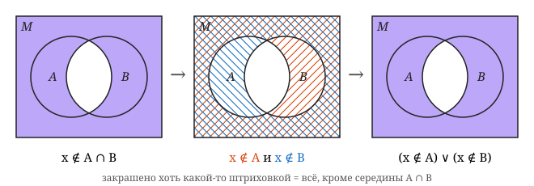

# Гл. I, § 2, задача 3

> Зорич, ч. I, 10-е изд., с. 10

**Статус:** ✅ решена

## Условие

Проверьте взаимосвязь (двойственность) операций объединения и пересечения:

a) $C_M(A \cup B) = C_M A \cap C_M B$;

b) $C_M(A \cap B) = C_M A \cup C_M B$.

## Решение

### a)

$$
\begin{aligned}
x \in C_M(A \cup B)
&\Leftrightarrow x \notin (A \cup B) \\
&\Leftrightarrow (x \notin A) \land (x \notin B) \\
&\Leftrightarrow (x \in C_M A) \land (x \in C_M B) \\
&\Leftrightarrow x \in (C_M A \cap C_M B)
\end{aligned}
$$

Так как это верно для любого $x \in M$, то $C_M(A \cup B) = C_M A \cap C_M B$.
Переход ко 2-й строке — закон де Моргана [§ 1, задача 2, пункт b)](../s1-logic-symbols/02.md#b);
то же доказательство — в [правилах Де Моргана](README.md#правила-де-моргана).

### b)

$$
\begin{aligned}
x \in C_M(A \cap B)
&\Leftrightarrow x \notin (A \cap B) \\
&\Leftrightarrow (x \notin A) \lor (x \notin B) \\
&\Leftrightarrow (x \in C_M A) \lor (x \in C_M B) \\
&\Leftrightarrow x \in (C_M A \cup C_M B)
\end{aligned}
$$

Так как это верно для любого $x \in M$, то $C_M(A \cap B) = C_M A \cup C_M B$.
Переход ко 2-й строке — закон де Моргана [§ 1, задача 2, пункт a)](../s1-logic-symbols/02.md#a).

## Заметки

