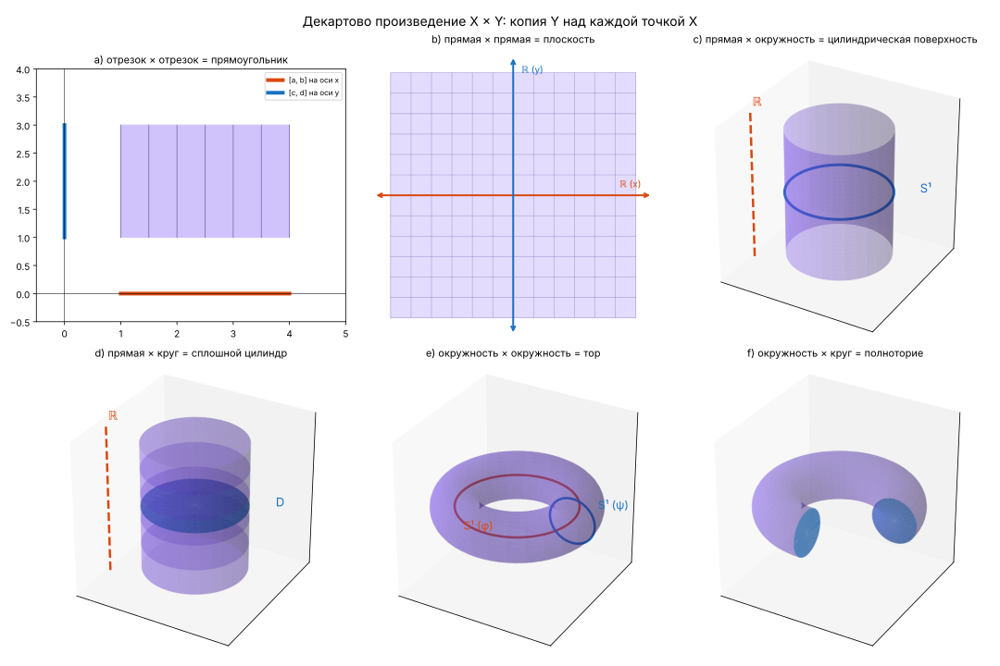

# Гл. I, § 2, задача 4

> Зорич, ч. I, 10-е изд., с. 10

**Статус:** ✅ решена

## Условие

Проиллюстрируйте геометрически декартово произведение:

a) двух отрезков (прямоугольник);

b) двух прямых (плоскость);

c) прямой и окружности (цилиндрическая поверхность);

d) прямой и круга (цилиндр);

e) двух окружностей (тор);

f) окружности и круга (полноторие).

## Решение

### a)

Отрезок $[a, b]$ × отрезок $[c, d]$ — прямоугольник:

$$
[a, b] \times [c, d] = \{(x, y) \mid a \le x \le b,\ c \le y \le d\}
$$

### b)

Прямая $X$ × прямая $Y$ — плоскость $XOY$:

$$
\mathbb{R} \times \mathbb{R} = \{(x, y) \mid x, y \in \mathbb{R}\}
$$

### c)

Прямая × окружность $S$ радиуса $r$: над каждой точкой $t$ прямой стоит своя копия окружности,
т. е. получается цилиндрическая поверхность:

$$
(t, \varphi) \mapsto (r\cos\varphi,\ r\sin\varphi,\ t), \quad t \in \mathbb{R},\ \varphi \in [0, 2\pi)
$$

### d)

Прямая × круг — то же, что в c), но вместо окружности берётся круг (окружность с внутренностью),
т. е. сплошной цилиндр:

$$
(t, \rho, \varphi) \mapsto (\rho\cos\varphi,\ \rho\sin\varphi,\ t), \quad t \in \mathbb{R},\ 0 \le \rho \le r,\ \varphi \in [0, 2\pi)
$$

### e)

Окружность × окружность: над каждой точкой одной окружности стоит копия другой,
т. е. получается тор (бублик):

$$
(\varphi, \psi) \mapsto \big((R + r\cos\psi)\cos\varphi,\ (R + r\cos\psi)\sin\varphi,\ r\sin\psi\big), \quad \varphi, \psi \in [0, 2\pi)
$$

### f)

Окружность × круг — заполненный тор (полноторие): в формуле из e) $r$ заменяется на $\rho \in [0, r]$.

## Заметки

