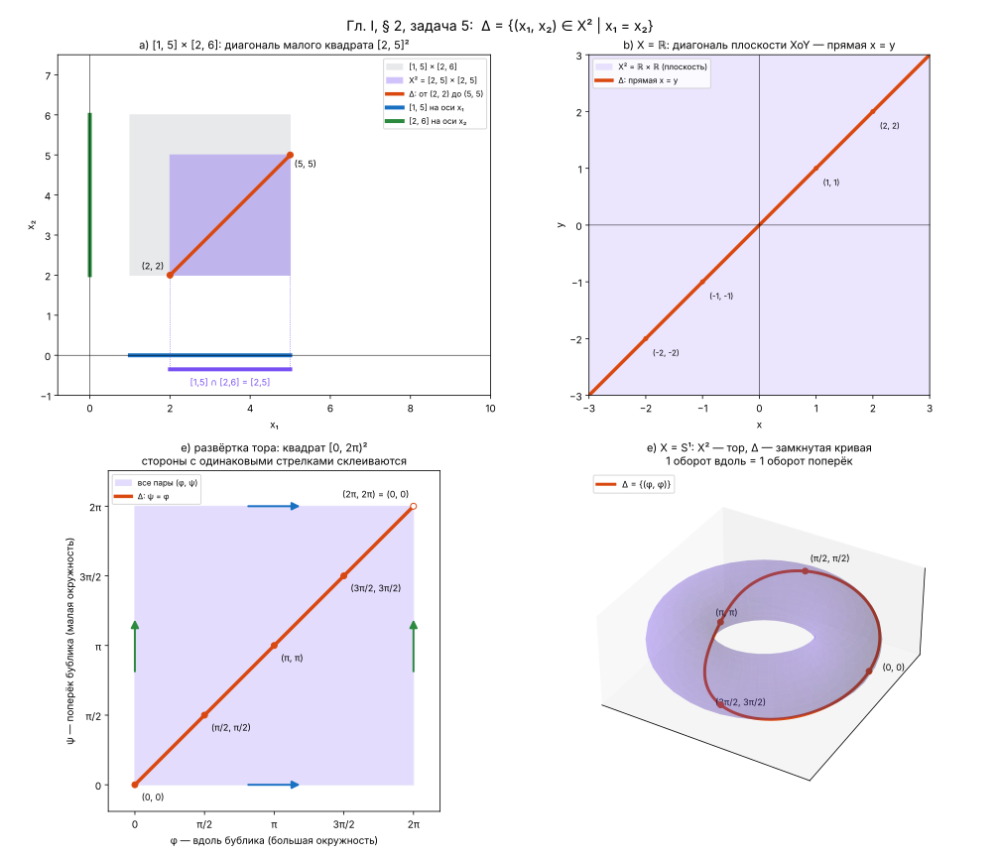

# Гл. I, § 2, задача 5

> Зорич, ч. I, 10-е изд., с. 10

**Статус:** ✅ решена

## Условие

Множество $\Delta = \{(x_1, x_2) \in X^2 \mid x_1 = x_2\}$ называется диагональю декартова квадрата $X^2$
множества $X$. Проиллюстрируйте геометрически диагонали множеств, полученных в пунктах a), b), e) задачи 4.

## Решение

### a)

Пусть $X = [a, b]$. Тогда $X^2 = [a, b] \times [a, b]$ — квадрат, а

$$
\Delta = \{(x, x) \mid a \le x \le b\}
$$

— его диагональ: отрезок от $(a, a)$ до $(b, b)$.

*Замечание.* Если перемножать два разных отрезка $[a, b] \times [c, d]$, это уже не декартов квадрат.
Точки с равными координатами в таком прямоугольнике всё же есть — это диагональ квадрата $[e, f]^2$,
где $[e, f] = [a, b] \cap [c, d]$, $e = \max(a, c)$, $f = \min(b, d)$.
Например, для $[1, 5] \times [2, 6]$ это отрезок от $(2, 2)$ до $(5, 5)$.
Если отрезки не пересекаются ($e > f$), таких точек нет.

### b)

$X = \mathbb{R}$, $X^2$ — плоскость $XOY$, диагональ $\Delta$ — прямая $y = x$.

### e)

Пусть $X = S^1$ — окружность. Её точки удобно задавать углом $\varphi \in [0, 2\pi)$.

1. $X^2 = S^1 \times S^1$ — все пары углов $(\varphi, \psi)$. Это тор:
   $\varphi$ — положение на большой окружности (вдоль бублика),
   $\psi$ — на малой (поперёк бублика).
   Размеры $R$ и $r$ нужны только для рисунка: как множества обе окружности одинаковые.
2. На плоскости все пары $(\varphi, \psi)$ — квадрат $[0, 2\pi) \times [0, 2\pi)$.
3. Точки с одинаковыми координатами, $\{(\varphi, \varphi) \mid \varphi \in [0, 2\pi)\}$, образуют
   диагональ $\Delta$ этого квадрата: отрезок, идущий из $(0, 0)$ к $(2\pi, 2\pi)$ (сам конец $(2\pi, 2\pi)$ не входит).
   На торе $\varphi = 2\pi$ и $\varphi = 0$ — одна и та же точка, поэтому отрезок замыкается в кривую.

**Как идёт кривая:** $(0, 0)$, $(\tfrac{\pi}{2}, \tfrac{\pi}{2})$, $(\pi, \pi)$, $(\tfrac{3\pi}{2}, \tfrac{3\pi}{2})$, снова $(0, 0)$.
За один оборот вдоль бублика она делает ровно один оборот поперёк.

**В координатах** (формула тора из задачи 4 e) при $\psi = \varphi$):

$$
\Delta: \varphi \mapsto \big((R + r\cos\varphi)\cos\varphi,\ (R + r\cos\varphi)\sin\varphi,\ r\sin\varphi\big), \quad \varphi \in [0, 2\pi)
$$

## Заметки

